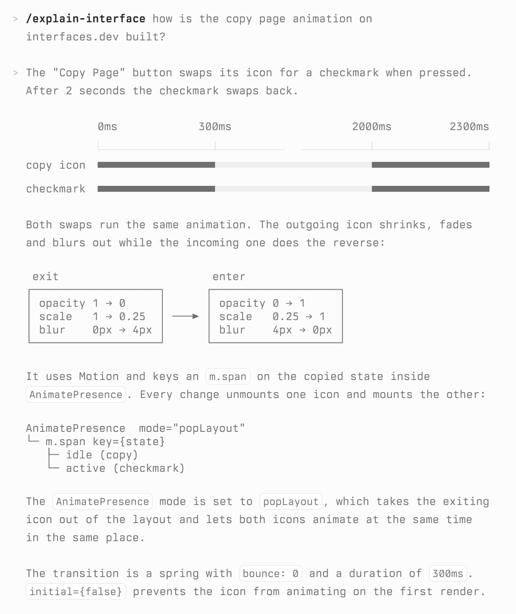
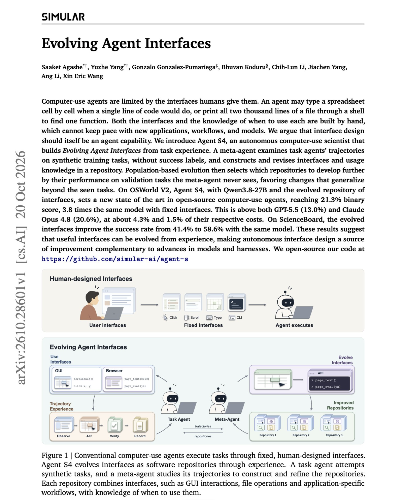
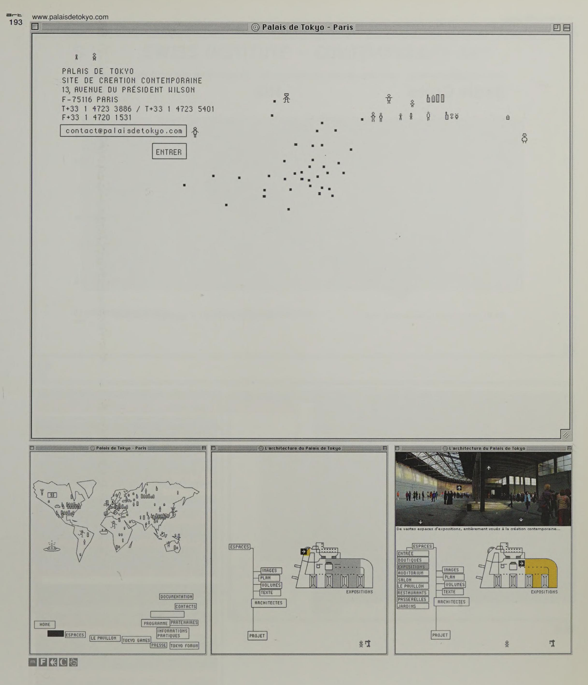

# Fungi UI design references

User-supplied inputs for a future design-research and spike handoff. **Collection only: no reference sites have been visited, no research or design spikes have been started, and no UI changes have been made for this request.** The user will hand this work to another agent.

## Direction from the user

The current `fungi-ui` style feels too “bootstrap”-like and not modern enough. The user wants to adjust the shared interface's visual style, using the references below as research inputs.

**ShowAI is a cautionary reference:** it feels like “too much, too messy, complex” to the user. Do not treat it as a wholesale target to reproduce.

No specific palette, typography, spacing system or overall design direction has been selected. The references are inputs for exploration, not approval to copy every visual treatment they contain.

## Named and linked references

Names and URLs are preserved as supplied. Wikipedia and shadcn were named without a particular page or version. The websites and repository have not been inspected or assessed here.

| Reference | User-supplied context |
| --- | --- |
| Wikipedia | Named design reference |
| shadcn | Named design reference |
| [Renaissance-Mind / ShowAI](https://github.com/Renaissance-Mind/ShowAI) | Feels like too much: too messy and complex |
| [Distill](https://distill.pub/) | Articles |
| [ciechanow.ski archives](https://ciechanow.ski/archives/) | Articles |
| [sonnet.io blog](https://sonnet.io/blog) | Articles |
| [Fabien Sanglard](https://fabiensanglard.net/) | Design reference |
| [Low-tech Magazine](https://solar.lowtechmagazine.com/) | Articles |
| [Growing SWE](https://growingswe.com/blog/) | Design reference |
| [MLU Explain](https://mlu-explain.github.io/) | Design reference |
| [hugo.blog](https://hugo.blog/) | Design reference |

## Attached visual references

All three original PNGs are copied into the wiki's attachments, preserving their bytes. Captions below identify the visible material; they do not infer which specific styling choices the user prefers.

### Image 1 — Interface explanation

Screenshot of an explanation of the Copy Page animation on interfaces.dev, with a timeline, transition diagrams and code-like text. This is a visual reference; the animation's implementation has not been investigated.

### Image 2 — Evolving Agent Interfaces

Screenshot of the first page of “Evolving Agent Interfaces,” showing its title, authors, abstract and explanatory figure. The paper is recorded as a supplied visual reference; its research and claims have not been evaluated.

### Image 3 — Palais de Tokyo

Supplied image showing a Palais de Tokyo website design across a large view and three smaller views. Its source, date and implementation have not been researched.

## Research observations — 2026-10-28

These are observations, not choices. The choices that followed are in the [theming decisions](planning.md#theming-decisions-accepted-on-2026-10-28).

The ten linked sites were rendered once in headless Chrome at 1280 px. Screenshots were kept outside the wiki; computed styles are recorded below. Wikipedia and shadcn were sampled through one article and one component page. ShowAI was not rendered.

| Reference | Ground | Text faces |
| --- | --- | --- |
| hugo.blog | Warm off-white `#fbf9f2` | Newsreader throughout, 20.8 px body |
| Distill | White | Georgia body, Hoefler Text headings, system sans for UI |
| Low-tech Magazine | Pale yellow `#fff5d1` | Times, 20 px |
| sonnet.io | Pale pink `#fff5f5` | EB Garamond |
| Wikipedia | Near-white `#f8f9fa` | System sans |
| ciechanow.ski | Light grey `#f8f8f8` | IBM Plex Sans body, Inter headings |
| growingSWE | White | SF Mono-family body and headings, dashed rules, boxed tags |
| shadcn | Dark in the rendered page | Geist |
| Fabien Sanglard | White | Roboto |
| MLU Explain | White | Amazon Ember, large illustrated sections |

Eight of the eleven references, counting the attached images, are light, reading-first article pages. Most separate content with rules and whitespace rather than boxed cards. The two typographic clusters are editorial serif (hugo.blog, Distill, Low-tech Magazine, sonnet.io, the arXiv page) and monospace (interfaces.dev, growingSWE, Palais de Tokyo).

During the round the user added [10 tells of slop](https://godobject.dev/blog/10-tells-of-slop/) as a rejection criterion. Its tells: gradients (especially purple), many unrelated colours, decorative badges, “fingernail” cards everywhere, emoji, misaligned unboxed elements, Inter or JetBrains Mono by default, prompt text leaking into the UI, glassmorphism or default brutalism, and hype copy.

## Handoff context

The next agent will handle design research and spikes using this collection. The target is the [shared UI kit](features/fungi-ui.md), consumed by outcome, grill-form and future workflows. Preserve the accepted [component composition decisions](planning.md#shared-ui-decisions-accepted-on-2026-10-28) and [UI authoring boundary](planning.md#ui-authoring-boundary-accepted-on-2026-10-28): workflows can compose and restyle components, while ordinary callers use mechanical assemblers without needing component knowledge.

Keep future observations, proposed directions and user-approved design choices distinct. No research findings or implementation commitments are implied by this reference list.
